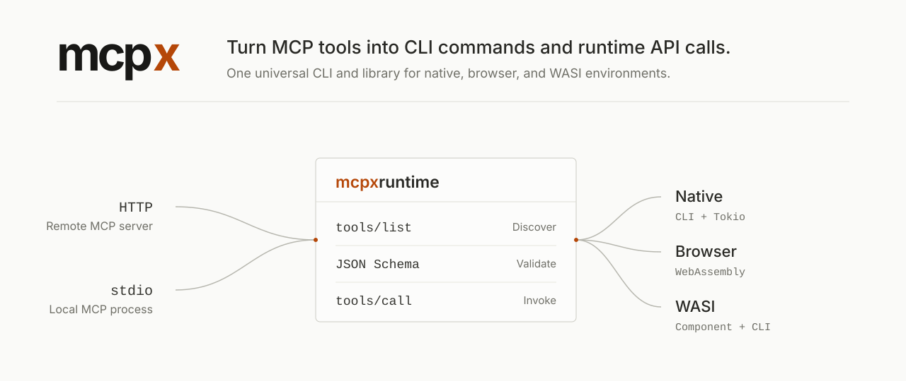

# mcpx



**Turn MCP tools into CLI commands and runtime API calls.**

`mcpx` is a general-purpose CLI and embeddable library for the [Model Context Protocol (MCP)](https://modelcontextprotocol.io/). Connect to MCP servers, discover their tools at runtime, and invoke them through one consistent command syntax or library API—across native Rust, browser WebAssembly, and WASI. No tool-specific client generation is required.

**[Documentation](docs/) · [Examples](examples/) · [Releases](https://github.com/reonokiy/mcpx/releases) · [Implementation status](docs/implementation-status.md)**

## Why mcpx?

- **A universal MCP CLI**: Discover tools and call them as `mcpx SERVER TOOL --flag value`, with schema-derived help, flags, and shell completion.
- **An embeddable library**: Use the same runtime bindings with typed Rust arguments, JSON, command strings, or argv instead of spawning a process.
- **Multiple environments**: Run the native CLI or Rust library locally, embed command-style invocation in browser Web Workers, or use the WASI Component API and standalone CLI.
- **Runtime discovery and validation**: Tool definitions come from the server, and arguments are validated against their input schemas before invocation.
- **No generated tool clients**: Add a server configuration and use its tools without generating a new CLI, Rust SDK, or TypeScript SDK for each service.

## Use it as a CLI

Download a prebuilt binary from [Releases](https://github.com/reonokiy/mcpx/releases), or run the CLI from this repository:

```bash
# List the tools exposed by the configured stdio MCP server.
cargo run -p mcpx-cli -- --config mcpx.example.toml tools demo

# Tool flags and help are derived from the server's schema.
cargo run -p mcpx-cli -- --config mcpx.example.toml demo echo --help

# Invoke the remote MCP tool like a local command.
cargo run -p mcpx-cli -- --config mcpx.example.toml demo echo --message "hello"
```

The included [example configuration](mcpx.example.toml) defines the `demo` server. After installing the `mcpx` binary, the invocation becomes:

```bash
mcpx --config mcpx.example.toml demo echo --message "hello"
```

Prefer structured input? Use the same tool through the explicit call route:

```bash
mcpx --config mcpx.example.toml call demo echo --args '{"message":"hello"}'
```

Direct HTTP endpoints work without a configuration file:

```bash
mcpx --url https://example.com/mcp tools
mcpx --url https://example.com/mcp TOOL --help
```

HTTP and stdio transports are available in the native CLI. Named server configuration, OAuth, text/JSON/NDJSON output, argument files, and dynamic Bash/Zsh/Fish completion are also supported.

## Use it as a library

Embed the same discovery, validation, command parsing, and invocation engine in an application. Prefer native tool bindings and argument builders in application code; CLI-style execution is also available when accepting command strings from users:

```rust,no_run
use mcpx::{native::Client, Dialect};

async fn example() -> mcpx::Result<()> {
    let mut remote = Client::new()?
        .connect("https://example.com/mcp", Dialect::Modern)
        .await?;

    // Native library API: bind the tool, build arguments, and call it directly.
    let search = remote.fresh_tool("search_repositories").await?;
    let args = search.args()
        .set("query", "rust")?
        .set("limit", 10)?
        .finish()?;
    let outcome = remote.call(&search, &args).await?;

    // Optional command interface: execute the same tool using CLI-style input.
    let command_outcome = remote
        .execute("search_repositories", "--query rust --limit 10")
        .await?;

    Ok(())
}
```

Typed Rust arguments, JSON objects, and argv are available as well. The caller owns the async runtime; no tool-specific Rust types are generated.

| Environment | Library and command interface |
| --- | --- |
| **Native** | Rust library and native CLI, with HTTP and stdio transports |
| **Browser** | JavaScript / Web Worker bindings powered by WebAssembly, with CLI-style commands over HTTP |
| **WASI** | Typed Component API and standalone WASIp2 CLI over `wasi:http` |

Explore the [browser CLI example](examples/web-worker/) and [WASI Component example](examples/wasi-component/) for complete embedding setups.

The native CLI searches for `mcpx.toml` in the current directory and then each
parent directory, using the nearest file. `--config FILE` overrides this search.
For example, `mcpx tools demo` and `mcpx demo echo --message hello` work from
any subdirectory of the configured project.

Configuration profiles own independent server names and OAuth login state:

```toml
schema_version = 1

[profiles.dev.servers.demo]
transport = "http"
url = "https://dev.example.com/mcp"

[profiles.prod.servers.demo]
transport = "http"
url = "https://prod.example.com/mcp"
```

```sh
mcpx --profile dev servers add remote --url https://example.com/mcp
mcpx --profile dev servers add local -- node server.mjs --read-only
mcpx --profile dev servers list
mcpx --profile dev tools demo
mcpx --profile dev auth login demo
```

List or switch profiles with:

```sh
mcpx profiles list
mcpx profiles use dev
```

`profiles use` saves `default_profile = "dev"` in the discovered configuration.
`profiles list` marks the saved default and the profile selected for this command.
Explicit `--profile NAME` overrides the saved choice without changing it.
Without a saved choice, the default is `default`.
The selected profile also scopes OAuth login, status, logout,
and automatic token refresh. Tokens stay in the existing credential store;
configuration files contain server settings and credential references only.
`servers add` writes to the discovered configuration (or creates `./mcpx.toml`),
creates the selected profile if needed, and rejects duplicate names within it.
Use `--config FILE` to choose the destination. Legacy `[servers.*]` files remain
readable as the default profile; adding a server migrates them into
`[profiles.default.servers.*]` while preserving comments.

## Development

Install [mise](https://mise.jdx.dev/), then run:

```sh
mise install
mise run setup
mise run build
mise run check
mise run test
mise run test:cli
mise run build:wasm
```

The mise configuration pins Rust 1.100.0 (with rustfmt, clippy and both Wasm
targets), Node 24, Python 3.12 and Wasmtime 50.0.1. `rust-toolchain.toml`
uses the same Rust version for editors and direct Cargo use. The library MSRV
remains Rust 1.88. `setup` installs locked npm dependencies, the matching
wasm-bindgen CLI and Playwright Chromium. Linux browser tests may additionally
need system libraries installed with `mise exec -- npx playwright install-deps chromium`.
Use `mise exec -- <command>` for other development commands, or activate mise
in your shell. WASI smoke tests use the mise-managed Wasmtime through `WASMTIME`.

## Documentation & support

To build the WebAssembly bindings from source, install the Rust targets
`wasm32-unknown-unknown` and `wasm32-wasip2`, run `npm ci --ignore-scripts`, and
install the matching binding tool with
`cargo install wasm-bindgen-cli --version 0.2.130 --locked --root target/tools`.
Run `npm run build:wasm -- --release` for size-optimized artifacts in `dist/web`
and `dist/component`. Release builds use LTO and a single codegen unit; Web
bindings additionally use `opt-level="z"` and pinned Binaryen `wasm-opt -Oz`,
with debug names removed. Component builds use `opt-level="s"`. These settings
apply only to the bindings build; native and standalone WASI CLI builds keep
their existing profiles. Omit `--release` for the regular debug build.

- [Technical design](docs/technical-design.md) and [implementation status](docs/implementation-status.md)
- Found a bug? [Open an issue](https://github.com/reonokiy/mcpx/issues).
- Have a question or feedback? Start a [discussion](https://github.com/reonokiy/mcpx/discussions).

---

*mcpx is licensed under the [MIT](LICENSE-MIT) or [Apache 2.0](LICENSE-APACHE) license.*
