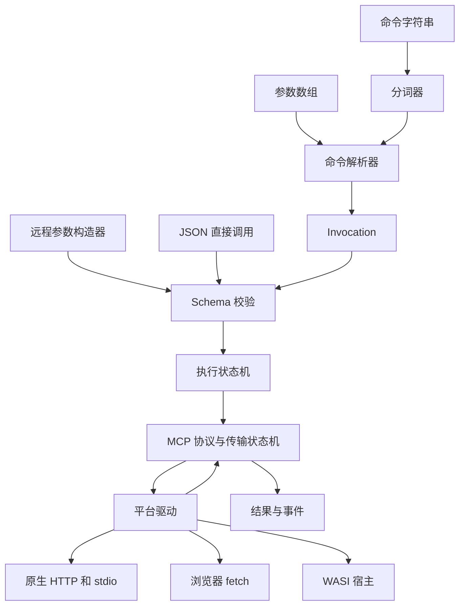

# mcpx 技术方案

日期：2026 年 11 月 13 日。状态：架构设计草案。面向首版实现和后续评审。

mcpx 是用 Rust 实现的 MCP 远程工具绑定与命令执行库。同一套工具发现、Schema 校验和协议逻辑服务于 Rust 应用、原生 CLI、浏览器 Wasm 和 WASI Component。工具接口在运行时从远端发现，不生成工具专属的 Rust 源码，也不要求应用预先声明入参 struct。

核心决策是以远程 ToolBinding 为中心：字符串命令、参数数组、动态参数构造器和 JSON 调用最终都进入同一个执行器。所谓带类型接口指远程 JSON Schema 驱动的运行时类型约束；未知工具不会在运行时变成 Rust 编译期方法或 struct。

本文中的 API、命令和资源限额是拟议设计，不代表已有实现或已发布接口。外部规范依据见文末，依赖版本在首轮跨平台验证通过后锁定。

## 1 产品范围

首版交付以下能力：

- 通过远程 HTTP 发现 MCP server 的工具，按需创建远程绑定。
- 由 inputSchema 校验直接调用和命令行调用，生成参数帮助与补全描述。
- 同时接收命令字符串、argv、参数构造器和 JSON 对象。
- 作为 Rust 库使用，并提供原生 CLI、浏览器 JS 包和 WASI Component。
- 提供结构化结果、进度、取消、超时和可区分的错误。
- 原生入口可连接 stdio 子进程；远程 HTTP 是跨平台的基础路径。

首版不包含通用 shell、管道、重定向、命令替换、任意程序执行、常驻 daemon、工具专属 SDK 生成、LLM sampling 实现或完整 prompts/resources 客户端。协议中遇到未支持的交互应明确返回能力错误或 NeedsInput，不能无限等待。

WASI 首先交付可嵌入组件。通过 wasi:http 和 wasi:cli 独立运行的 WASI 命令是后续入口，不能把可导入组件宣传为已经具备独立联网能力的 WASI CLI。

## 2 使用体验

### 2.1 远程绑定

```rust
// 概念 API：平台驱动由调用方注入。
let client = Client::builder().driver(driver).build()?;
let remote = client.connect("https://example.com/mcp").await?;
let search = remote.tool("search_repositories").await?;

let args = search.args()
    .set("query", "rust")?
    .set("limit", 10)?
    .finish()?;

let result = search.call(args).await?;
```

tool() 负责按需取得目录、定位工具并编译可复用的校验器。set() 接收实现 Serialize 的值，保存其 JSON 类型；finish() 执行完整对象校验。call() 在发送前再次检查绑定版本和授权上下文。

### 2.2 命令字符串和参数数组

```rust
let engine = Engine::new(client);
engine.register("github", remote)?;

let result = engine.execute(
    r#"github search_repositories --query rust --limit 10"#,
).await?;

let result = engine.execute_argv(&[
    "github", "search_repositories", "--query", "rust", "--limit", "10",
]).await?;
```

execute() 只增加分词步骤，之后与 execute_argv() 完全相同。以上 argv 不包含程序名；原生 main 负责从操作系统参数中去掉程序名。首版采用有效 UTF-8 输入，原生遇到非 UTF-8 参数返回明确错误。

### 2.3 直接 JSON 调用

```rust
let result = search.call_json(serde_json::json!({
    "query": "rust",
    "limit": 10
})).await?;
```

call_json() 仍经过同一个输入校验器。调用方已有自己的 Rust 类型时，ToolBinding::args_from 和 Client::call_typed 接收 Serialize 对象，ToolResponse::deserialize<T: DeserializeOwned> 解析结构化结果；原生 QueuedBinding 提供相同构造与提交入口。这些辅助方法不生成工具 SDK，不取代远程 Schema，不把文本输出猜成 JSON，也不自动恢复 NeedsInput。

## 3 总体架构



协议层采用 Sans-I/O：接收字节、时间和宿主事件，产生待执行动作，不直接访问网络、时钟或操作系统。命令层只负责输入变换，所有入口共用参数校验和结果语义。

逻辑层允许使用 std 和堆内存，但不要求文件系统、线程或操作系统网络。首版不承诺 no_std。库内部不创建全局 runtime，不调用 process::exit，不直接打印，不依赖全局环境变量。

## 4 Workspace 和依赖方向

```text
mcpx/
  crates/
    mcpx/                  公共库 facade
    mcpx-core/             目录、绑定、校验、调用状态机、结果
    mcpx-protocol/         MCP 消息、版本流程、HTTP/SSE/stdio 状态
    mcpx-command/          分词、CommandSpec、动态解析、帮助和补全
    mcpx-native/           Tokio 驱动、HTTP、子进程、配置 adapter
    mcpx-wasi/             WASIp2 HTTP/poll 驱动
    mcpx-config/           可选配置模型、纯文本解析、显式文件加载
    mcpx-cli/              binary 名称 mcpx
    mcpx-web/              Wasm 导出、JS 驱动与 Promise 包装
    mcpx-component/        WIT 接口和组件资源管理
  wit/                     宿主动作和组件资源定义
  tests/fixtures/          Schema、协议消息、分块流
  tests/conformance/       入口与平台一致性测试
  examples/                Rust、Web、WASI 嵌入示例
  docs/technical-design.md
```

依赖方向固定为 protocol <- core <- command；native/WASI 驱动 core/protocol；可选 config 依赖 core，提供配置模型及显式文件加载；CLI 组合对应驱动、config 和 command；web/component 组合 core、protocol 及可选 command；facade 通过 features 提供便捷导出。protocol 不依赖 core，因此协议数据类型只能定义在 protocol 或由其拥有的 model 模块中。

mcpx 默认导出与平台无关的绑定和执行接口。command、native-http、native-stdio 是可选能力；web/component 使用独立构建入口，防止 Cargo feature 合并把原生网络或进程依赖带进 Wasm。原生异步 runtime 必须由入口或应用拥有。

这些 crate 表示最终职责边界。M0 可以先把 core 内部的目录、Schema 和 engine 作为模块实现，避免过早拆成更多公共包。

## 5 核心数据模型

| 类型 | 含义与约束 |
| --- | --- |
| Client | 连接注册、操作调度和驱动入口，不代表全局单例 |
| Remote | 本地逻辑连接及授权上下文；现代 MCP 无协议会话时仍可存在 |
| CatalogSnapshot | 一次完整分页发现的工具集合，带本地 generation 和获取时间 |
| ToolDescriptor | 原始工具名、说明、输入输出 Schema、annotations 和保留的扩展字段 |
| ToolBinding | Remote 引用、工具名、Schema 指纹、校验器和目录 generation |
| ArgsBuilder | 绑定某个工具版本的 JSON 对象构造器 |
| BoundArgs | finish 后的对象及绑定身份，不能悄悄用于其他工具 |
| CommandSpec | 与解析器无关的命令、参数与名称映射描述 |
| Invocation | 服务器标识、原始工具名、参数对象、绑定版本和调用选项 |
| Operation | 一次发现、调用或订阅的生命周期，以独立 ID 标识 |
| CallOutcome | Completed(ToolResponse) 或 NeedsInput(Continuation)，区分结果与未完成交互 |
| ToolResponse | MCP 原始内容、结构化内容、工具失败状态和输出校验诊断 |

目录 generation 只表示本地快照版本。Schema 指纹通过明确、固定的 JSON 规范化算法计算，用于本地变化检测，不等同于服务端签名或版本承诺；数组顺序不能随意排序。

ToolBinding 的失效策略是显式的：已观察到 Schema 或授权变化时，在发送前返回 BindingStale，要求重新绑定或明确刷新。未观察到的服务端变化仍可能导致远端拒绝，本地校验不能保证执行时 Schema 没有变化。

刷新是原子操作，分页中途失败不发布部分目录。绑定默认使用不可变快照，刷新不偷偷改变正在构造的 ArgsBuilder 的解释方式。

## 6 Schema 驱动的参数接口

### 6.1 构造和校验规则

set(name, value) 不做字符串猜测：Rust 字符串永远序列化成 JSON string，整数、布尔值、对象和数组保留对应类型。默认重复设置同一个字段返回 DuplicateArgument；确需覆盖时使用 replace()，避免偶然覆盖。

set() 可以在类型无歧义时提前报告明显错误，但不单独校验每个子 Schema，也不因未知字段立刻拒绝。字段可能受 oneOf、条件分支、patternProperties 或 unevaluatedProperties 影响。最终由 finish() 对整个对象执行完整校验，错误发生时仍能指出具体路径。

字段缺省、显式 null 和具体值必须区分。Schema default 作为提示，不自动写入对象；不做字符串到数字的隐式转换，不裁剪文本，不忽略未知参数。未知属性是否允许完全遵循 Schema，不能擅自把未指定 additionalProperties 解释为 false。

数组和嵌套对象通过 Serialize 或 JSON value 直接传入，首版不把点号字段名解释成对象路径，避免与真实字段名冲突。

### 6.2 Schema 范围

输入以工具返回的原始 Schema 为准。未声明方言时按 MCP 对应版本规定处理；首版基础方言为 Draft 2020-12。properties、required、enum、const、组合约束、条件、数组和引用的校验交给 jsonschema，不重新实现一套简化校验器。

jsonschema 关闭默认网络和文件解析功能，只使用已在内存登记的资源。其文档提供浏览器和 WASI 支持路径，但内置 HTTP 引用获取不适用于这些目标，因此须验证所锁版本及 feature 组合。[jsonschema Wasm 支持](https://docs.rs/jsonschema/latest/jsonschema/#webassembly-support)

文档内部的 $ref/$defs 保持原有基址语义，由校验器解析；不盲目展开递归引用。外部引用首版返回 SchemaReferenceUnavailable，不自动联网或读本地文件。后续允许宿主提供受控的 SchemaRegistry 后，先异步预取资源，再执行纯内存编译。

不能编译、缺少必要方言能力或要求不支持 vocabulary 的 Schema 不得降级成“校验通过”。工具可被列出并显示诊断，但调用返回 SchemaUnsupported。format 按明确的 annotation 策略处理，扩展 keyword 默认保留；不能宣称未知 keyword 已被验证。

### 6.3 校验器缓存和诊断

校验器按 Schema 指纹、方言和策略版本缓存，设置容量和内存预算。错误至少包含 code、instance_path、schema_path 和不包含敏感参数原文的 message，采用 JSON Pointer 表示路径。可返回多个错误，但受数量限制，避免复杂组合产生无限诊断。

### 6.4 数值语义

首版支持 serde_json 可无损表达的 i64/u64 整数及有限 f64，拒绝 NaN、Infinity 和超出支持范围的数字，不能静默舍入。精确十进制、任意精度数字作为单独能力评估，不在不同入口使用不一致的自动转换。

原始 JSON 文本在转换成 Value 前须保留并检查数字 token，超出 i64/u64 的整数字面量不能由默认解析器降级成 f64。已有 Value 无法恢复调用方先前丢失的精度，因此其数值表示视为调用方提供的实际值；文档和 API 不承诺还原这些值的原始数字文本。

JS 包在进入 Wasm 前拒绝超出 Number 安全整数范围的 integer；大整数使用显式包装器或原始 JSON 文本入口。返回值也必须通过保留大整数的编码桥接，不能先转换成普通 JS Number 再报警。任意精度开关若会改变校验语义，需在全平台同时启用后发布。

## 7 命令设计和解析

### 7.1 命令形式

```bash
mcpx --help
mcpx servers list
mcpx tools github
mcpx github search_repositories --help
mcpx github search_repositories --query rust --limit 10
mcpx call github search_repositories --args '{"query":"rust","limit":10}'
mcpx call github search_repositories --args-file request.json
```

固定管理命令的名称保留，注册 alias 时拒绝冲突。call 是通用入口，不要求生成业务 flags，可定位工具原始名称。动态调用优先保持原始名称；可选的连字符别名只有在不冲突且可合法表示时才生成，不静默覆盖。

### 7.2 两阶段解析

第一阶段识别固定命令、全局选项和 server alias，不连接所有服务器。全局选项固定在 server/tool 路由之前，例如 mcpx --output json github tool ...，避免远程工具的 output 参数与宿主选项混淆。

第二阶段只获取目标 server 的目录，为所选工具构建 CommandSpec 和 clap Command。使用 try_get_matches_from 和 render_help；help/version 是正常结果，库不退出进程。[clap Command API](https://docs.rs/clap/latest/clap/struct.Command.html#method.try_get_matches_from)

### 7.3 自动参数映射

| Schema | CLI 表达 | 规则 |
| --- | --- | --- |
| string | --query rust | 保留原始文本，不把 null/true 当特殊值 |
| integer | --limit 10 | 十进制整数，范围检查，不先经过 f64 |
| number | --threshold 0.5 | 有限数值，按首版数值范围检查 |
| boolean | --archived true | true/false 显式值，区分缺省 |
| 单一原始类型 enum | --state open | 先按类型转换，再执行 Schema 校验 |
| object / array | --filter '{"owner":"x"}' | JSON 文本，不提供隐式逗号拆分 |
| nullable / 联合 / 无确定类型 | 完整 --args | 首版不猜测分支 |

required 仍在完整对象校验时确认。属性名与 help 等保留参数冲突或不能映射为合法 flag 时，help 标注需使用 --args，不能使整个工具不可调用。Schema 到 flags 是易用性投影，完整校验始终使用原始 Schema。

完整 --args 与生成的业务 flags 互斥。--args-file 属于原生 CLI 的输入源扩展，由宿主先读取再交给同一 JSON 路径；浏览器通过文件选择器或直接 JSON 对象提供等价输入。不得通过命令字符串触发未授权的文件访问。

### 7.4 字符串语法

定义跨平台一致的有限分词语法：空白分隔，单引号内原样保留；双引号内允许转义双引号和反斜杠；未引用时反斜杠转义下一字符；保留空字符串参数。未闭合引号和末尾悬空转义返回位置错误。

不展开环境变量、通配符或波浪线，不执行命令替换，不解释 shell 控制符。原生 CLI 使用系统已分词的 argv，不对其二次分词。所有宿主可直接传 argv，绕开字符串转义。

### 7.5 帮助与补全

CommandSpec 同时服务文本 help、网页参数说明和结构化 completion API。补全返回当前 token、候选项、参数说明与可选枚举；静态 shell completion 不能冒充掌握随时变化的远程工具。动态补全使用授权隔离的目录缓存，冷启动可明确要求刷新。

## 8 MCP 协议范围与兼容

### 8.1 版本范围

首个完整版本计划支持 2026-07-28 和 2025-11-25；这是一项实现范围承诺，须通过各自的测试后才能标为支持，不自动推断兼容更早版本。

现代模式按每次请求携带版本、身份和能力，并使用 server/discover 发现服务端信息；旧版模式执行 initialize/initialized 并管理旧版状态。两种模式采用独立策略，不把现代协议假定为必须先初始化。[现代版本兼容规范](https://modelcontextprotocol.io/specification/2026-07-28/basic/versioning)、[旧版生命周期](https://modelcontextprotocol.io/specification/2025-11-25/basic/lifecycle)

Auto 模式先进行无业务副作用的 discovery。识别到现代版本不支持错误时，从共同支持集合选版本；只有匹配规范定义的旧版探测条件才进入旧版握手。401/403、TLS 失败、DNS 失败和普通网络错误都不能被当成降级依据。支持显式指定版本，便于诊断和受控环境使用。

发现流程重试有次数和总时限上限；绝不拿 tools/call 作为版本探针。stdio 探针超时后应清理未决请求；必要时重建子进程后执行旧版握手，避免迟到响应污染新流程。

### 8.2 HTTP

支持 application/json 和 text/event-stream，SSE 采用增量解码，覆盖 UTF-8 跨 chunk、CRLF、注释、多行 data 和 EOF。传输状态机负责版本对应的 header、session 和响应关联，平台驱动只负责 HTTP I/O。

现代 HTTP 与旧版 HTTP 的 GET 流、session、恢复和取消机制不同，按版本隔离实现；现代模式不得沿用旧版 GET/session/Last-Event-ID 逻辑。[Streamable HTTP 规范](https://modelcontextprotocol.io/specification/2026-07-28/basic/transports/streamable-http)

HTTP 状态先经认证和版本策略分类，再处理协议数据。保留必要的响应头及诊断，不记录凭据。现代 Schema 可能声明参数到 HTTP header 的映射，协议模块按规范处理并限制保留 header，远程 Schema 不能覆盖 Authorization、Host 等宿主控制字段。

### 8.3 stdio

使用换行分隔 JSON-RPC，标准输出只按协议消息处理，stderr 单独作为日志。子进程启动使用 executable 和 argv，不经 sh -c。关闭时先关闭输入并等待，超时后由原生驱动执行平台终止流程。[stdio 规范](https://modelcontextprotocol.io/specification/2026-07-28/basic/transports/stdio)

### 8.4 首版方法与能力

范围包含 discovery/旧版初始化、tools/list 分页、tools/call、进度、取消和目录失效。现代输入请求表示成 NeedsInput，调用方可通过 continuation 显式恢复；旧版未支持的 server request 按对应版本返回能力错误。不得宣告没有实现的 sampling、roots、elicitation 自动处理或任务能力。

listChanged 只有在对应版本的通知路径可用且已实际接收时才触发即时失效；否则使用 TTL 和显式 refresh。内容类型、扩展字段与未知可保留消息采用前向兼容存储，不能把未知业务消息误判成成功。

## 9 执行状态机与宿主驱动

核心引擎按操作维护状态，提供 start、accept_input、drain_actions、cancel 和 dispose 等基础操作。异步 Client 是这套接口的便捷包装；WASI 和 Web 无需持有跨绑定边界的 Rust Future。

| 宿主动作 | 宿主输入 | 语义 |
| --- | --- | --- |
| OpenHttp | HttpHeaders / IoError | URL、method、header、body 和 host request ID |
| ReadHttp | HttpChunk / HttpEof / IoError | 按需拉取有界字节块，形成背压 |
| OpenProcess | ProcessOpened / IoError | 仅有进程能力的宿主可执行 |
| WriteStream | WriteComplete / IoError | 写入请求字节，完成前不重复发送 |
| ReadStream | StreamChunk / StreamEof | 与 HTTP 共用有界拉取约定 |
| ArmTimer | TimerFired | 由宿主单调时钟实现，携带 timer ID |
| CancelIo / CloseIo | IoClosed | 取消或释放宿主资源，允许迟到输入被丢弃 |

这是概念动作表；稳定 ABI 需要进一步确定字段。operation ID、action ID、host resource ID 和 JSON-RPC ID 分开，不能复用一个编号。重复、失序或已释放操作的输入有明确错误/丢弃规则，避免双重完成。

状态机每次驱动返回有界动作和事件，零动作时宿主等待 I/O 或 timer，不能 busy loop。terminal result 只发布一次；取消和结果竞争时，以先接受的终态为准。清理动作仍需执行，不因操作结束遗留连接和计时器。

原生 driver 可以在 Tokio 任务中拥有状态机，通过消息通道接收并发请求；不能在网络 await 期间持有全局锁。浏览器和组件默认单线程、单所有者，核心不强制 Send。原生提供单独的线程安全句柄，其 Send/Sync 由实现实际保证，不使用 unsafe 伪造跨线程能力。

## 10 结果和错误语义

### 10.1 返回结果

ToolResponse 保存原始 content 列表、structuredContent、工具 isError、协议扩展元数据及输出校验状态。客户端不能把文本 content 猜测成 JSON 并当作结构化输出，也不默认下载资源链接。

输出校验状态至少区分 NotDeclared、Valid、Invalid 和 NotApplicable。成功返回且声明 outputSchema 时，缺少结构化内容或违反 Schema 进入 Invalid，保留原始响应。工具业务失败和 NeedsInput 走各自语义，不盲目套用成功输出 Schema。工具输入输出 Schema 的协议依据见工具规范。[MCP 工具规范](https://modelcontextprotocol.io/specification/2026-07-28/server/tools)

普通 call 返回 Result<CallOutcome, McpxError>：本地、网络和协议失败进入 Err；工具 isError 仍保存在 Completed 的响应中；需要继续交互时返回 NeedsInput。call_checked 额外把工具业务失败和输出不符合契约转换成携带原始响应的错误。两者对输入都严格校验；CLI 根据 outcome 设置退出码，不把所有 Ok 都解释为成功。可选 deserialize<T>() 仅提供调用方自定义 Rust 类型的解析便利。

### 10.2 错误分类

| 类别 | 示例 | 调用是否可能已执行 |
| --- | --- | --- |
| Input | 分词失败、参数冲突、Schema 校验失败 | 否 |
| Binding | 找不到工具、绑定失效、授权上下文变化 | 发送前失败时否 |
| Capability | Schema 不支持、宿主无进程能力 | 否 |
| Auth | 凭据缺失、远端认证失败 | 由协议响应判断 |
| Transport | 连接失败、断流、非法 HTTP 响应 | 可能 |
| Protocol | JSON-RPC 错误、关联错误、版本不支持 | 由具体错误判断 |
| Timeout / Cancelled | 截止时间或取消 | 可能 |
| ToolFailure | 工具返回 isError | 已收到工具结果 |
| OutputValidation | 输出违背契约 | 已收到工具结果 |
| NeedsInput | 需要调用方继续交互 | 操作尚未完成，保留 continuation |

错误对象包含稳定 code、operation_id、必要的 JSON Pointer、retry advice 和 execution certainty。CLI 与 JS/WIT 不通过解析自然语言 message 判断错误类型。

表中的 ToolFailure、OutputValidation 和 NeedsInput 也作为结构化状态分类使用，不意味着普通 call 一定把它们放进 Result::Err。UI 以 outcome 和响应状态展示最终完成、业务失败或待输入；受检接口才按前述规则提升为错误。

### 10.3 输出模式

CLI 支持 text、json 和 ndjson-events。text 默认输出文本内容，对非文本给出摘要；json 返回含原始结果和诊断的 mcpx envelope；ndjson-events 输出逐行事件及最终记录。日志在 stderr，机器可读 stdout 不混入进度提示或 ANSI 转义。

拟议退出码：0 成功/help，1 工具失败或输出违约，2 输入/Schema 错误，3 配置/绑定/能力错误，4 认证错误，5 传输或协议错误，6 超时，7 未完成的 NeedsInput，130 用户取消。库不使用退出码表达内部错误。

## 11 进度与交互

事件至少包含 operation_id、单调递增 sequence、事件 kind 和 payload，覆盖 Discovery、Bound、Progress、Log、NeedsInput、Completed、Failed、Cancelled。时间戳由宿主提供，缺失不影响协议正确性。

MCP 进度是工具报告的进度，不能当作 token 流或完整业务结果流。只有协议明确表示完成后才能发布 Completed。事件队列设置容量；高频 Progress 可合并，Log 可按策略丢弃并发出计数，终态不得静默丢弃。宿主停读时暂停相关输入或明确返回 ConsumerLagged。

Continuation 绑定 Remote、授权身份、操作、协议版本和有效期，不默认序列化到磁盘。调用方显式提供响应后继续同一交互；不替用户自动填写敏感字段，也不自动调用其他工具。

## 12 平台实现

### 12.1 Rust 库与原生 CLI

平台无关 mcpx crate 导出绑定、参数和结果，command feature 增加命令接口。mcpx-native 提供 Tokio driver、reqwest HTTP 和 stdio 子进程。CLI 主函数负责创建 runtime、载入配置、安装 Ctrl-C 处理和选择输出格式。

HTTP 连接池与 Remote 生命周期分离；多个操作可复用传输资源。单次 CLI 调用完成后关闭资源；Rust 应用可保留 Client。所有操作应支持显式关闭，Drop 只能做不阻塞的资源回收兜底。

### 12.2 浏览器

目标为 wasm32-unknown-unknown，使用 wasm-bindgen 提供固定的通用 API 绑定。这里生成的是 Rust/JS 语言互操作胶水，不生成远程工具专属 SDK。网络由 fetch、ReadableStream 和 AbortController 驱动。

优先放在 Web Worker：状态机、目录和校验器留在 worker；主线程通过 operation ID 接收事件和结果。JS execute、tool、call、cancel 接口包装消息通信，不依赖共享内存或线程。

```javascript
// 概念 API：tool 返回通用远程句柄，不生成工具专属 JS 方法。
const remote = await client.connect("https://example.com/mcp");
const search = await remote.tool("search_repositories");
const outcome = await search.call({ query: "rust", limit: 10 });
```

JS 对象通过统一桥接保留缺省/null 区别，undefined 属性按缺省处理；拒绝循环引用、函数等不可表示的值。worker 中的远程句柄映射到本地 ID，dispose 后拒绝复用。Promise 成功 resolve 只表示得到 CallOutcome，业务成功仍按相同结果契约判断。

直接访问远端需要正确的 CORS 和可读取的协议响应头；浏览器不能自行设置受限 header，也不能修改 Origin 伪装绕过服务端检查。Authorization、版本和旧版 session header 的预检/暴露配置应在示例中验证。SSE 用 fetch body 流，不依赖无法满足 POST/header 需求的原生 EventSource。

浏览器不直接启动本机 stdio MCP server。此类连接需用户部署本地或后端桥接服务；桥接凭据与浏览器端凭据分离，不把宿主长期密钥自动下发给网页。

### 12.3 WASI Component

目标为 wasm32-wasip2，定义自有 WIT world，导出 engine resource，内部持有目录、绑定和操作状态。Rust 该目标输出 Component，宿主须支持相应组件接口。[Rust WASIp2 文档](https://doc.rust-lang.org/rustc/platform-support/wasm32-wasip2.html)

拟议资源方法包括 start-connect、start-list-tools、start-bind、validate-args、start-command、start-call、accept-input、drain-actions、drain-events、cancel、close。绑定完成返回 descriptor 和本地 binding ID；validate-args 与 start-call 都使用该 ID，并执行与 Rust 相同的版本和身份检查。固定 ID、错误和字节数据使用 WIT record/variant/list；工具 Schema、业务参数和扩展内容以 JSON 文本承载。字节 chunk 使用 list<u8>，不能把任意网络字节误当 UTF-8。

WIT 方法本身短时、同步返回，宿主异步执行 drain-actions 取到的 I/O，再通过 accept-input 恢复。调用方不需要让 Rust Future 穿过 WIT，也不要求 JSPI。操作结束释放其 I/O；engine resource 关闭后所有后续访问返回资源错误。

宿主只执行低层 HTTP/stream/timer 动作，不替组件完成工具发现或协议解析。因此核心 MCP 能力仍在 Rust/Wasm 中，不是一个仅把调用转发给宿主 SDK 的空包装。

后续增加独立 WASI CLI 时，适配 wasi:cli、wasi:io 和 wasi:http，并显式验证目标运行时是否提供这些接口。未来通过 jco 在浏览器加载组件也需要映射宿主能力，不视为无成本替代当前浏览器构建。[jco 转换说明](https://bytecodealliance.github.io/jco/transpiling.html)

## 13 配置与凭据

```toml
schema_version = 1

[profiles.default.servers.github]
transport = "http"
url = "https://example.com/mcp"
protocol = "auto"
credential = "github-token"

[profiles.default.servers.local]
transport = "stdio"
program = "example-mcp-server"
args = ["--mode", "read-only"]
```

配置只保存凭据引用。CredentialProvider 根据当前调用返回凭据及非敏感 auth_context_id；核心不读取环境变量或 keychain。原生可选环境/系统凭据存储，Web 由应用注入，WASI 由宿主提供。凭据不进入工具目录、错误文本或默认日志。

核心接受已经解析的结构化配置。可选 mcpx-config 负责纯文本 TOML 解析；native/WASI CLI 在入口显式加载文件，WASI 依赖宿主 preopen/env/cwd 能力。浏览器可直接使用结构化配置或纯文本解析，无需虚拟文件系统。Remote 的别名、endpoint 和凭据策略由注册阶段确定，普通工具参数不能修改。

## 14 缓存与远程变更

目录缓存 key 包含规范化 endpoint、transport、协议版本、auth_context_id、租户和目录策略版本，不直接包含 secret。Schema 校验器缓存再加入内容指纹和方言。不能单凭 server alias 或 URL 跨身份共享工具可见性。

首版默认内存缓存，目录 TTL 建议 60 秒，可配置。协议版本提供有效缓存元数据时按其约束收紧；凭据权限变化时 CredentialProvider 必须推进 auth_context_id 或使目录失效。公开缓存优化后续单独实现。

目录过期后调用默认先刷新；离线 help 可以使用旧目录，但标注 stale。tools/list 分页检测重复 cursor、冲突的同名工具、页数和总工具数上限。单次 refresh 只发布完整快照，同一 server 的并发 refresh 合并。

本地 schema_generation 能阻止已知变化下误用旧参数；服务端实际调用仍是最终权威。不能为了修复 Schema 变化自动重放可能已执行的工具操作。

## 15 取消超时与重试

每个操作有总 deadline，连接、读空闲、交互等待可另设子限额，所有计时依赖宿主单调时钟。超时和取消会发出版本对应的协议/流取消及资源关闭动作，不承诺远端副作用已经回滚。

工具调用默认不自动重试，也不把工具 annotations 当作可靠幂等保证。即使没有收到响应，只要请求可能已写出，就标记执行结果未知。目录发现等无业务副作用操作可在总 deadline 内有限重试；版本探测重发仅限其受控流程。

调用方若明确提供 RetryPolicy，必须指定适用操作、最大次数、退避和允许的执行不确定性。首版没有通用“失败就重试”开关。重建 stdio 子进程不重放未完成工具调用。

## 16 资源限额与运行边界

以下是初始可配置默认值，需在 M0 验证后调整，并非性能测量结果。

| 项目 | 初始限额 |
| --- | --- |
| 单个 Schema | 1 MiB，引用资源总量独立计费 |
| 单次工具参数 | 1 MiB |
| JSON 响应或目录快照 | 16 MiB |
| 单条 SSE event / stdio message | 8 MiB |
| JSON 嵌套深度 | 64 |
| 每个 server 工具数 / 分页数 | 10000 / 100 |
| 每个 Client 并发操作 | 16，额外操作排队且可取消 |
| 事件队列 | 256 条，另设 4 MiB 字节预算 |
| 总调用 deadline | 60 秒，长任务需显式覆盖 |
| discovery / 连接超时 | 10 秒且受总 deadline 约束 |
| 单次返回校验错误数 | 32 |

校验器缓存初始最多 128 项，并额外采用内存预算；M0 需要测定编译 Schema 的放大比例，不能用原始 Schema 大小代替实际占用。

JSON 深度和 Schema 复杂度均设预算。限制正则回溯和输入长度；Schema 编译/校验是同步计算，外层异步 timeout 不能强制打断它，必须靠校验器配置、工作预算或 worker/宿主隔离限制耗时。无法设定合理上限的复杂 Schema 明确拒绝。

解码后的文本和帮助输出需转义终端控制字符，保留原始内容供结构化接口读取。原生 HTTP 禁止把凭据随跨源重定向转发；如允许跳转应重新应用凭据与 endpoint 策略。核心不自动拉取外部 Schema、资源 URL 或执行工具描述中的指令。

## 17 技术选型

| 部分 | 选型 | 边界与理由 |
| --- | --- | --- |
| 模型与序列化 | serde、serde_json | 公共动态数据边界，统一数值策略 |
| Schema 校验 | jsonschema，关闭默认 I/O features | 运行时 Schema，不依赖工具专属代码生成 |
| 错误 | thiserror | 稳定 code 加结构化上下文 |
| 命令解析 | clap Builder，启用动态字符串支持 | 从 CommandSpec 创建解析器，使用 try API |
| 字符串分词 | 小型自有有限语法解析器 | 精确定义跨平台语义，需属性测试 |
| 原生异步与网络 | Tokio、reqwest | 只进入 native 构建，流式 body 和取消 |
| Web 语言绑定 | wasm-bindgen、相关 JS 互操作库 | 导出固定通用 API，动态工具仍由 Schema 绑定 |
| WASI 语言绑定 | wit-bindgen | 固定组件 ABI，不生成工具专属接口 |
| 诊断 | tracing | 由宿主安装 subscriber，避免默认记录业务参数 |
| 协议实现 | 自有 Sans-I/O 状态机 | 在不同宿主共用协议行为和测试 |
| SDK 对照 | 官方 rmcp | 互操作参考与测试端，不作为全平台强制依赖 |

rmcp 当前 HTTP client trait 仍有 Send future 约束，其 local 模式不能直接证明所有传输在浏览器可用。因此先隔离 SDK，禁止为兼容约束引入不可靠的 unsafe Send 包装。[rmcp HTTP backend 源码](https://github.com/modelcontextprotocol/rust-sdk/blob/main/crates/rmcp/src/transport/streamable_http_client.rs)

依赖以技术验证通过的发布版本锁定，不能按 main 分支源码推断已发布版本具备相同行为。rust-version/MSRV 随跨目标构建验证确定；Cargo.lock 与 JS 锁文件一并保存。公共 Rust API 不暴露 clap、reqwest、Tokio 或 rmcp 的具体类型。

## 18 测试与验收

### 18.1 参数与绑定

覆盖必填、缺省/null、整数边界、联合类型、条件约束、$ref、未知属性、重复 set、恶意 Schema 和失效绑定。同一参数分别通过字符串、argv、builder 和 JSON 进入，检查最终 JSON 对象相同；不要求 JSON object 的文本字段顺序相同。

测试 finish 全对象校验，确保没有把分支 Schema 的局部判断当成最终结论。对分词和参数转换使用属性测试与 fuzz，特别覆盖引号、空字符串、Unicode、保留参数、名称冲突和数值溢出。

### 18.2 协议与传输

按现代/旧版分开测试版本选择、认证不降级、JSON/SSE、session、分页和输入请求。用同一响应的所有关键切分方式验证 UTF-8/SSE 增量解析；覆盖 HTTP 中途断流、stdio stderr、迟到响应、未知 ID、取消竞争和超时清理。

fixture 必须明确所属协议版本，不能把旧版响应形状复制成现代协议测试。mock server 外，使用公开发布的官方 SDK 构建测试服务做互操作验证，记录实际 SDK 与协议版本。

### 18.3 平台一致性

CI 对原生、wasm32-unknown-unknown 和 wasm32-wasip2 分开构建并检查依赖图。浏览器运行 headless 集成测试，验证 fetch/CORS/header/取消；WASI 使用支持 Component Model 的运行时和最小宿主驱动真实执行，不能用 cargo check 代替运行验证。

所有平台跑同一个远程测试工具，比较发现结果、参数、校验错误 code、事件顺序约束和最终结果。驱动采用虚拟时钟和可记录 I/O 进行确定性回放。原生额外测试子进程生命周期和无 shell 启动。

### 18.4 首版发布条件

- 无工具代码生成即可发现远端工具，并通过 builder 和字符串完成调用。
- 参数错误在发送前阻止调用，Schema 校验没有静默绕过路径。
- 三个平台完成真实 HTTP JSON 与 SSE 调用、取消和资源释放。
- 支持声明中的两个协议版本均有独立互操作测试，能力范围可查询。
- Rust 库可不启用 command/native features；全局 runtime、stdout 和进程退出不泄漏到核心。
- 浏览器与 WIT 对大整数、字节流、错误和操作句柄使用一致编码约定。
- 明确区分失败、未完成和可能已执行，超时后不自动重放工具调用。

性能报告应分别测量绑定/Schema 编译、缓存命中校验、解析、协议处理和宿主 I/O，报告样本规模与环境，不把网络延迟混进核心性能指标。

## 19 实施阶段

| 阶段 | 交付 | 验收重点 |
| --- | --- | --- |
| M0 跨平台基础验证 | jsonschema/clap 依赖验证、核心动作原型、最小 WIT 和 JS 驱动 | 同一 Schema 在原生/Web/WASI 中编译校验；网络流取消原型可运行 |
| M1 绑定与命令 | CatalogSnapshot、ToolBinding、ArgsBuilder、CommandSpec、四入口转换 | 不依赖网络 fixture 完成一致参数与错误验证 |
| M2 现代远程 HTTP | 2026-07-28 discovery、tools、JSON/SSE、NeedsInput、超时 | 原生端真实调用；Web/WASI 同步验证宿主动作契约 |
| M3 平台运行闭环 | Rust async facade、CLI、Web Worker、Component 宿主示例 | 三平台真实服务调用与事件/取消/清理一致 |
| M4 兼容与 stdio | 2025-11-25 独立策略、自动探测、原生子进程、目录失效 | 版本边界、认证、session 和进程测试通过 |
| M5 首版发布准备 | 凭据注入、限额、文档、examples、锁版本与 CI | 满足首版发布条件，明确列出剩余能力 |

WASI 独立 CLI、远程 SchemaRegistry、持久化缓存、jco 组件分发和更多 MCP 特性在首版之后单独评估，不应成为 M1 的前置依赖。

## 20 待验证决策

以下事项有默认方向，不阻止按 M0 开始实现；验证结果决定具体依赖版本和 ABI，而非重新讨论已确定的产品范围。

| 事项 | 默认方向 | 验证失败后的调整 |
| --- | --- | --- |
| Schema 校验体积和执行预算 | jsonschema 无内置 I/O，Draft 2020-12 | 明确限制 Schema 能力并报告，不退回不校验 |
| 动态 CLI 在 Wasm 的体积 | clap Builder，精简可选 features | 替换 CommandSpec 后端，不改变核心绑定 |
| WIT 动作粒度和流吞吐 | 有界 pull chunk，批量动作和事件 | 合并调用与缓冲，维持同一背压语义 |
| JS 大整数桥接 | 显式包装器或保真 JSON 文本 | 限制 API 可表示范围并拒绝，不静默舍入 |
| 现代与旧版工具互操作 | 双策略加明确支持矩阵 | 收窄发布支持范围，不能把未测版本标为支持 |
| 核心并发成本 | 单所有者状态机，原生消息驱动 | 按连接分片，不给所有核心类型强加 Send |

## 21 规范与实现参考

- [MCP 工具与输入输出 Schema](https://modelcontextprotocol.io/specification/2026-07-28/server/tools)
- [MCP 现代版本与旧版兼容](https://modelcontextprotocol.io/specification/2026-07-28/basic/versioning)
- [MCP 旧版生命周期](https://modelcontextprotocol.io/specification/2025-11-25/basic/lifecycle)
- [MCP Streamable HTTP](https://modelcontextprotocol.io/specification/2026-07-28/basic/transports/streamable-http)
- [MCP stdio](https://modelcontextprotocol.io/specification/2026-07-28/basic/transports/stdio)
- [官方 Rust SDK](https://github.com/modelcontextprotocol/rust-sdk)
- [jsonschema](https://docs.rs/jsonschema/latest/jsonschema/)
- [clap Builder API](https://docs.rs/clap/latest/clap/_tutorial/index.html)
- [Rust WASIp2 target](https://doc.rust-lang.org/rustc/platform-support/wasm32-wasip2.html)
- [jco 组件转换](https://bytecodealliance.github.io/jco/transpiling.html)


OAuth 优先级已调整为 P0：alpha.2 首先交付原生 CLI 登录/刷新、身份隔离和共享授权协议；浏览器/WASI 交互由各宿主适配，详见 implementation-status.md 与 README 的 OAuth 说明。
